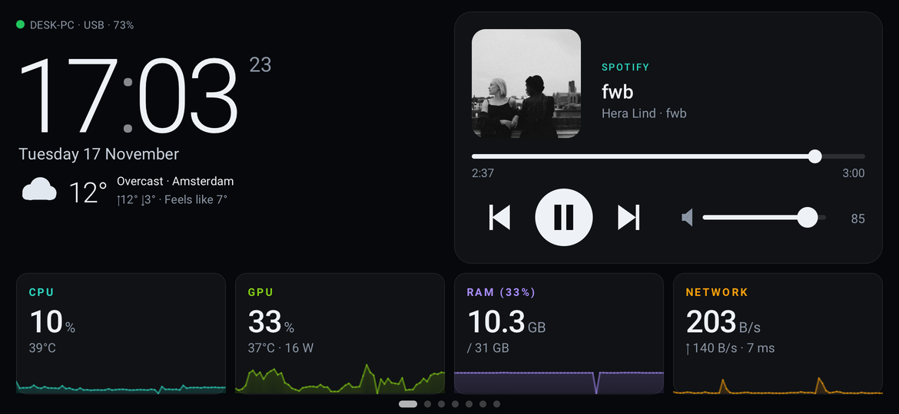
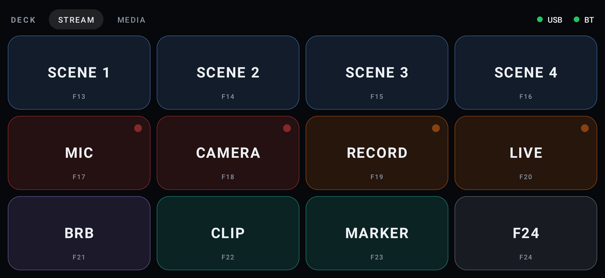
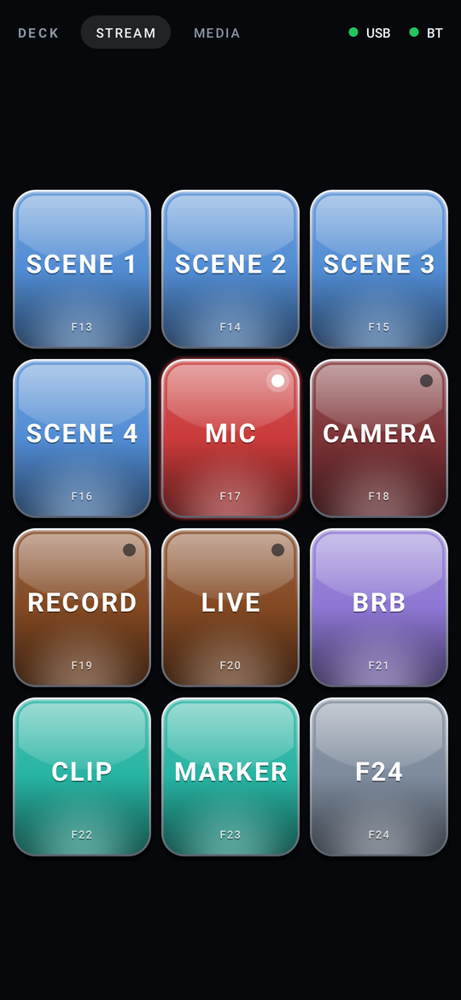
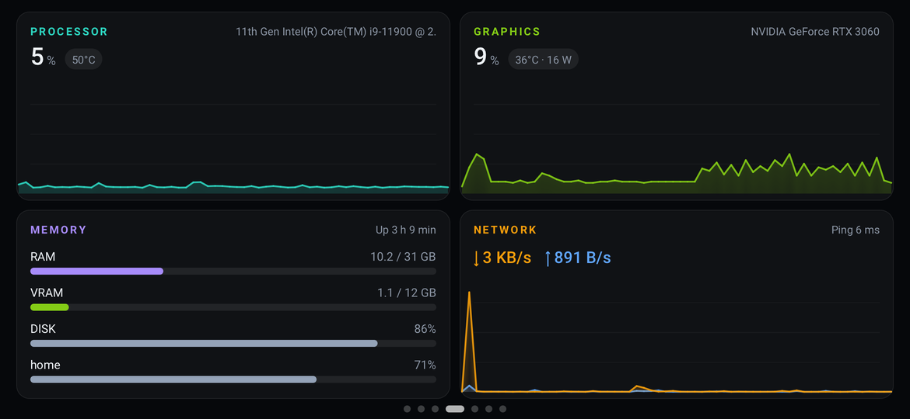
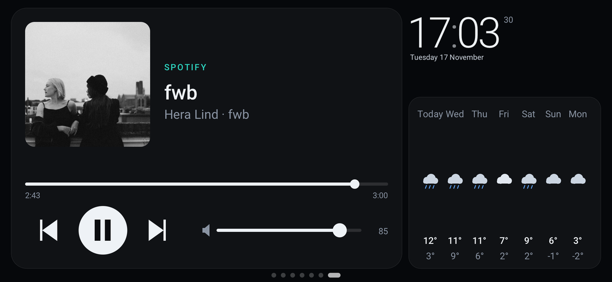
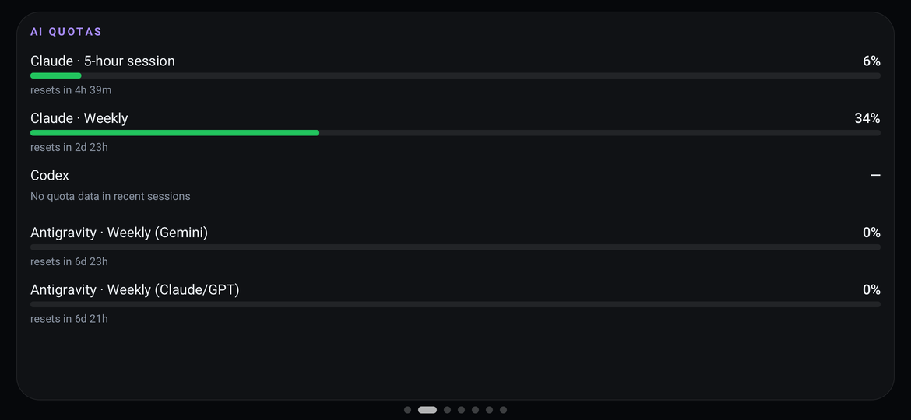
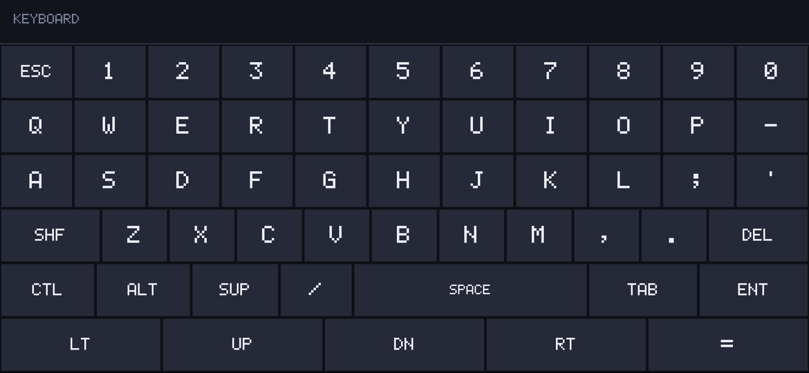
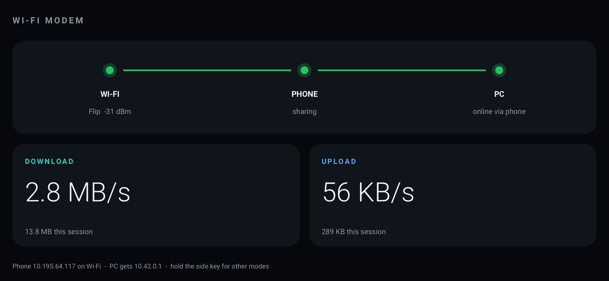
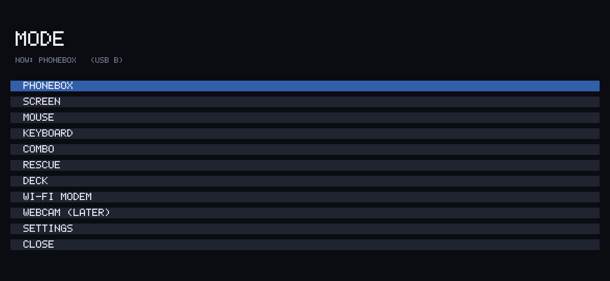

# PhoneKit

**Turn an old phone into your own hardware toolkit. Like [phonebox](https://github.com/ersinkoc/phonebox),
but it's an operating system, not an app.**



An old phone is a great piece of hardware: a sharp touchscreen, a battery, USB, Bluetooth, Wi-Fi, buttons and
sensors in a box that fits your hand. PhoneKit drops Android and keeps the hardware, so one phone can be many
gadgets. Switch between them with the side button, in about two seconds:

- **A desk dashboard for your PC.** Clock, weather, now playing, CPU/GPU/RAM, AI usage quotas, app launchers.
  It works with the stock phonebox desktop agent, so there's nothing new to install on the PC.
- **A stream deck.** Big buttons that send hotkeys to OBS, Discord or anything else. Push-to-talk works, and so
  do media keys, over USB or Bluetooth.
- **A USB monitor with touch.** It plugs into a Linux PC as a second screen, no driver install.
- **A keyboard and trackpad** for a TV box, tablet, media PC or another phone, wired or over Bluetooth.
- **A Wi-Fi modem.** Plug it into a PC with no Wi-Fi (a desktop, a server, a Raspberry Pi) and the PC gets
  internet through the phone's Wi-Fi, no driver needed.
- **A server crash cart.** A terminal for a server's serial console, or blind typing into a headless machine.
- **Whatever you build.** Any script, Home Assistant setup or microcontroller can draw on the screen and read
  touches with [PPJ/1](protocol/PPJ1.md), plain JSON lines over TCP. Or change the C code: it's small, and MIT.

| | |
|---|---|
|  |  |
| **DECK**: a stream-deck style hotkey pad (MIC is lit: toggles glow) | **Upright too**: turn the phone and the keys follow |
|  |  |
| **PHONEBOX**: your PC's vitals at a glance | **PHONEBOX**: media controls and the week's weather |
|  |  |
| **PHONEBOX**: AI plan usage and reset times | **KEYBOARD**: a USB or Bluetooth keyboard |
|  |  |
| **WI-FI MODEM**: the PC goes online through the phone | **One phone, many modes**: hold the side button |

All of these are real screenshots from a Samsung XCover Pro running PhoneKit.

**How:** phonebox runs as an app on top of full Android. PhoneKit removes Android entirely: the phone boots a
trimmed Linux kernel and one small native program, `paneld`, which owns the screen, touch, buttons, battery and
USB. It boots in seconds, idles at a fraction of Android's power draw, and charges the battery only to a safe
40–60 % window, so it can stay plugged in for years.

**Why:** a phone that still works isn't obsolete, just abandoned. Read the [manifesto](MANIFESTO.md).

> [!WARNING]
> **This is not an app you install. You will unlock a bootloader and flash a modified boot image to your phone.**
> Unlocking usually wipes the phone, can void the warranty, and on Samsung trips Knox permanently.
> A bad flash can leave the phone stuck until you recover it from download/fastboot mode.
> Only do this with a phone you no longer need for anything else. There is no guarantee it will work on your
> phone, see [Who this is for](#who-this-is-for).

<!-- TODO: photo of the XCover Pro on a desk in PHONEBOX mode -->

## Who this is for

cleanyourtv-style projects work through settings your device already gives you. This one doesn't: it's for
people who are comfortable with (or want to learn):

- unlocking a bootloader and flashing partitions (Odin/heimdall, fastboot, mtkclient)
- reading a kernel log when the screen stays black
- building a kernel, or at least running a build script and reading its errors
- recovering a phone from download mode when something goes wrong

You don't need to know all of it up front. The [prompt](PROMPT.md) lets an AI coding assistant (Claude Code,
Codex, Gemini CLI, …) do most of the work with you, step by step, and it asks before anything risky. But the
assistant can't press the phone's buttons, and it can't promise your phone will work. **Some phones can't be
done** (locked bootloaders, no kernel source, display stacks that need Android). Budget a weekend for a first
port, and expect dead ends.

**Freedom to change it.** Everything here is MIT licensed (kernel patches are GPL-2.0, like the kernel). Take
it and turn it into whatever you want: a home-automation wall panel, a car dash, a synth controller, a
dedicated keyboard. paneld is a few thousand lines of plain C with no framework to fight.

## What it does

One image, switchable at runtime with the phone's side buttons (or from the host):

| Mode | What the phone is | Host needs |
|---|---|---|
| **PHONEBOX** | A desk dashboard driven by the stock [phonebox](https://github.com/ersinkoc/phonebox) desktop agent: its pages, live PC stats, media and shortcut buttons, drawn natively on the phone (no Android, no WebView). Custom hosts (scripts, microcontrollers) can drive the same screen with [PPJ/1](protocol/PPJ1.md). Battery-optimized: it draws only what changes | The phonebox agent (Windows/Linux/macOS), or anything that speaks PPJ/1 (JSON lines over TCP) |
| **SCREEN** | A USB monitor + touchscreen (GUD display + HID digitizer), ~50 fps at 1080×2340 | Linux with the `gud` module. No driver install |
| **MOUSE** | A trackpad | Nothing (standard HID) |
| **KEYBOARD** | A keyboard | Nothing (standard HID) |
| **COMBO** | Keyboard + trackpad | Nothing (standard HID) |
| **DECK** | A stream-deck style hotkey pad: pages of big buttons sending key combos (F13–F24 by default), media keys, key sequences or text, over USB or Bluetooth ([guide](docs/deck.md)) | Nothing: bind the keys as hotkeys in OBS, Discord, ... |
| **WI-FI MODEM** | Shares the phone's Wi-Fi with the PC over the USB cable (NAT + DHCP), with a status screen: link, live speed, totals ([guide](docs/modem.md)) | Nothing: the USB network is driverless on Linux and Windows |
| **RESCUE** | A terminal for a server's serial console, plus blind typing over HID ([guide](docs/rescue.md)) | A serial console on the server |
| WEBCAM | planned | |
| FLASH DRIVE | planned: mass storage for a portable debug toolkit | |

The keyboard, trackpad and DECK modes also work over **Bluetooth** (the phone pairs as a keyboard + mouse with
phones, tablets, TVs and PCs).

Plus: rotation (auto via the phone's sensor hub, or manual) in every mode, an on-device Settings screen with a
Wi-Fi manager (scan, type the password on screen) and Bluetooth pairing, a charge limiter and thermal guard, a
watchdog, and a debug serial console over USB. Radios stay off unless needed, and by default also while a computer
is on the cable. **How to use the buttons, the mode menu and Settings: [docs/settings.md](docs/settings.md).**

**Works with phonebox desktop.** Install the [phonebox agent](https://github.com/ersinkoc/phonebox) on your PC as
usual and plug the phone in, in PHONEBOX mode. The agent finds it over adb by itself, exactly as it finds a phone running
the phonebox app: PhoneKit answers adb, accepts the agent's USB tunnel and renders its pages natively. You don't need
the Android app, and you don't need any PhoneKit software on the PC. Widget coverage grows over time; see
[docs/verification/M12b.md](docs/verification/M12b.md) for the current table.

## Status

Early, working, one device. See [ROADMAP.md](ROADMAP.md) and the verification records in
[docs/verification/](docs/verification/).

| Device | SoC | Display | Touch | USB modes | Rotation | Panel protocol |
|---|---|---|---|---|---|---|
| Samsung Galaxy XCover Pro (SM-G715FN) | Exynos 9611 | ✅ | ✅ 10 fingers, 28 ms | ✅ | ✅ | 🟨 in progress |

Want to add your phone? That's what the [porting guide](docs/porting-guide.md) and [prompt](PROMPT.md) are for.

## Start here

| You have… | Do this |
|---|---|
| A supported phone (table above) | [Install on a supported phone](#install-on-a-supported-phone) |
| Another phone with an unlockable bootloader | Paste [PROMPT.md](PROMPT.md) into your coding assistant, or read [docs/porting-guide.md](docs/porting-guide.md) |
| A phone with a locked bootloader (most US carrier phones, many Huawei/Xiaomi-after-2023) | Not possible, sorry. Look at phonebox instead |
| Just curiosity | [docs/how-it-was-built.md](docs/how-it-was-built.md), the story of the first port |

## Quick start with an AI assistant

1. Clone this repo and open it in your coding assistant (it reads [AGENTS.md](AGENTS.md); in Claude Code the
   `port-phone` skill in `.claude/skills/` loads automatically).
2. Paste the contents of [PROMPT.md](PROMPT.md) and tell it your phone model.
3. Follow along. It checks whether your phone can be done before touching it, makes a known-good backup first,
   and asks before every flash.

## Install on a supported phone

The safe layout: keep a normal ROM (e.g. LineageOS) on the **boot** partition and flash PhoneKit to
**recovery**. Power on → your ROM. Recovery combo (or `adb reboot recovery`) → PhoneKit. Nothing about your
ROM changes, and if PhoneKit misbehaves, its watchdog reboots back to the ROM by itself. Keeping Android
is a feature: the phone stays a phone, and you always have a working OS to fall back to.

| Layout | Power on → | Trade-off |
|---|---|---|
| **Dual** (recovery), default | your ROM; PhoneKit via the recovery combo | Your ROM's recovery is replaced (see below) |
| **Dedicated** (boot) | PhoneKit directly | No Android left; fastest; recovering needs download/fastboot mode |
| **A/B slot** (phones without a recovery partition) | the active slot | Planned ([M6f](ROADMAP.md)) |

> [!NOTE]
> **For technical users:** in the dual layout your ROM's own recovery is gone. On non-A/B phones, ROM OTA updates
> (LineageOS updater) install *through recovery*, so they stop working. Flash the ROM's recovery back to update,
> then reflash PhoneKit. A `make restore-recovery` helper and an on-device maintenance menu (reboot to
> download mode, partition backup over USB) are planned in [M6f](ROADMAP.md).

Needs on the PC (Linux): `aarch64-linux-gnu-gcc` (static glibc), `mkbootimg`/`unpack_bootimg`, `avbtool`,
`python3`, `adb`, and `heimdall` (Samsung) or `fastboot`. For a source kernel build: `clang`/`lld`.

```bash
git clone https://github.com/MrCloudy2/phonekit-os && cd phonekit-os
```

```bash
make import device=samsung-xcoverpro IMG_SRC=/path/to/your/recovery.img
```

```bash
make device=samsung-xcoverpro
```

Then either flash from download mode (`make flash device=samsung-xcoverpro`) or, with a rooted-debugging
userdebug ROM running, `make deploy` (dd over adb, verify, reboot into PhoneKit). Talk to it:

```bash
scripts/ppctl.py --wait 90 info
```

Full details per device are in `devices/<device>/device.yaml`.

## Doing it by hand

| Tool | What it does |
|---|---|
| `make import` | Take kernel/DTB/DTBO from a known-good boot or recovery image |
| `make` | Build paneld + initramfs + boot image (kernel prebuilt or from source: `KERNEL=source`) |
| `make deploy` | Write the image over adb from the ROM (keeps the settings area), verify sha256, reboot into it |
| `make update` | Same, from PhoneKit itself over the USB control channel: ~13 s, no ROM round trip |
| `make flash` | Flash from download/fastboot mode |
| `make logs` | Read paneld's log from the last boot (`last_kmsg`) |
| `make test` | Run paneld under qemu (no phone needed) |
| `scripts/ppctl.py` | Control channel: info, screenshots, touch injection, modes, power, a shell |
| `scripts/test-*.py` | Hardware test suites (touch, display, power, USB, keys, input modes) |
| `host/ppj.py` | Python client for PANEL mode; `host/demo_dashboard.py` is an example |

## When something goes wrong

Read [docs/recovery.md](docs/recovery.md) **before** your first flash. The short version: always keep a
known-good image of every partition you touch, know your phone's download/fastboot button combo, and never
flash `boot` until `recovery` works.

## Questions people ask

**Why not just use phonebox?** If your phone runs Android fine and you're happy with that, do! PhoneKit is
for when you want instant boot, very low idle power, years of safe always-plugged charging, a USB monitor
mode, or simply no Android.

**Will it brick my phone?** A *hard* brick is very unlikely if you only flash boot/recovery and keep the
bootloader intact. A *soft* brick (stuck on the logo) happened several times during the first port, and every
time it was fixed by flashing the known-good image from download mode. See [docs/recovery.md](docs/recovery.md).

**Windows/macOS?** PANEL, MOUSE, KEYBOARD and COMBO are standard USB/network, so they work. SCREEN mode needs
Linux's `gud` driver for now.

**Does it need a battery?** Currently yes. Battery-less boot is on the roadmap (phones with removable
batteries make it testable).

## Legal

Independent project, not affiliated with or endorsed by phonebox, Samsung, Google, LineageOS, or any phone
maker. Brand names are trademarks of their owners. This repository contains no vendor firmware or proprietary
blobs: you import the kernel binaries from an image you already have. Unlocking and flashing may void your
warranty. **You do this at your own risk. The software is provided "as is", without warranty of any kind.**

## License

[MIT](LICENSE), with the spirit of it in the [manifesto](MANIFESTO.md), for everything except `devices/*/kernel-patches/` (GPL-2.0, matching the Linux kernel).
