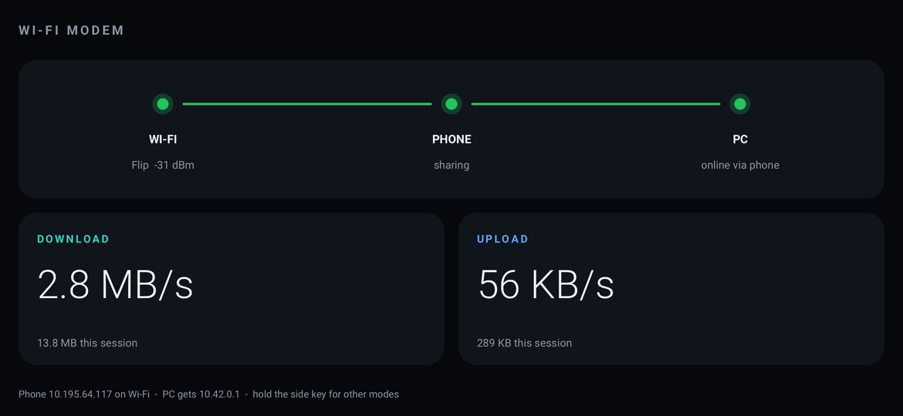

# WI-FI MODEM: the phone as a USB Wi-Fi adapter

WI-FI MODEM shares the phone's Wi-Fi with whatever it's plugged into over USB. A desktop or server without Wi-Fi,
a Raspberry Pi or a mini PC gets internet through the cable, with no driver to install: the phone shows up as a
USB network adapter (RNDIS by default; NCM in Settings → USB NETWORK, for macOS).



## Use it

1. Put the phone on Wi-Fi once, from the PC (you type the password; it stays on the phone):
   ```sh
   scripts/ppctl.py wifi set "NETWORK" "PASSWORD"
   ```
   A phone hotspot works too: then the PC is online over mobile data.
2. Hold the side button → **WI-FI MODEM**, or from the PC: `scripts/ppctl.py mode modem`.
3. The phone replugs its USB so the PC takes the new settings right away. Within a few seconds the screen shows
   three green dots: Wi-Fi → phone → PC.

Leave it by picking another mode; the PC goes back to its own internet. The choice is remembered across reboots.

## What the screen shows

- **WI-FI**: the network and its signal (dBm). **PHONE**: sharing, or waiting for Wi-Fi. **PC**: online via the
  phone once the PC took its address (10.42.0.1).
- **DOWNLOAD / UPLOAD**: live speed as seen by the PC, and the total since the mode started.

## If the PC already has internet

The PC decides which connection it prefers. In the test (Linux, NetworkManager, wired internet), the PC kept its
wired connection first and the phone second, so nothing moved over by itself. That is usually what you want; to
send everything through the phone, unplug the other connection. To try it for one program only:
`curl --interface <usb interface> https://example.com`.

## Details

- The phone NATs the USB network (10.42.0.0/24) out of its Wi-Fi and hands the PC 10.42.0.1 by DHCP, with the
  phone (10.42.0.2) as router and the Wi-Fi network's DNS server.
- `scripts/ppctl.py wifi tether on|off` turns the same sharing on without the modem screen, for example together
  with PHONEBOX: the PC takes it at its next DHCP renewal or replug.
- Mobile data as the uplink depends on the phone: Qualcomm modems can work (ModemManager); Samsung Exynos modems
  need Android's closed radio stack, so not on the XCover Pro. Some carrier plans restrict tethering.
